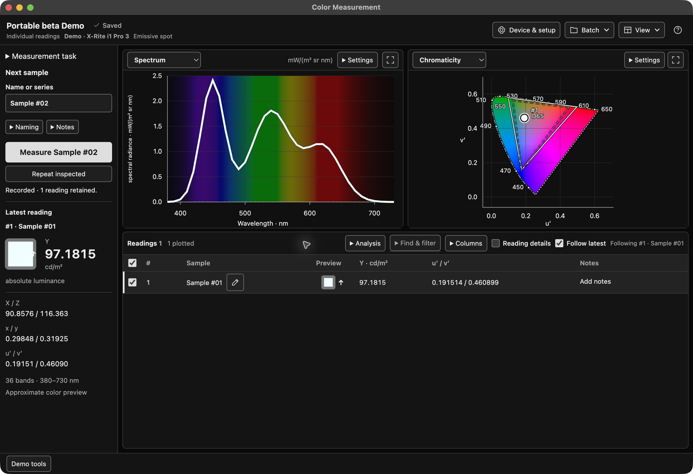

# Color Measurement

A color-measurement app for collecting readings, comparing spectra and colors,
and keeping results for further analysis. The desktop app has a web-based interface
and runs offline, without MATLAB.

**Beta: testers wanted.** Help us check setup, everyday use, saved results and
instrument behavior. You can start with Demo without owning an instrument.
Physical instrument operation and measurement accuracy have not been validated;
use real equipment only after reading the [instrument guide](docs/testing-with-an-instrument.md).



*The portable workspace on macOS with a simulated Demo reading. Preview colors are illustrative.*

## What you can do

- **Collect and organize readings.** Name samples, add notes and save them in batches.
- **See spectra and colors together.** Inspect linked plots, chromaticity and a reading table.
- **Compare samples.** Review XYZ, Lab, color differences and spectral differences with explicit reference conditions.
- **Measure guided charts.** Track patch positions, repeats and missing readings, then continue a saved chart in a new batch.
- **Review and export.** Reopen saved results and export JSON, CSV or MAT; other formats depend on the available quantities.
- **Recover from save errors.** Retry saving or choose another folder using the retained readings.
- **Use your own scripts.** Python and command-line interfaces are available alongside the desktop workspace.

## Download the app

- [**Apple silicon Mac**](https://github.com/ferazambuja/color-measurement-app/releases/download/v0.1.0-beta.3/Color-Measurement-0.1.0-macos-arm64.zip), macOS 27 or later.
- [**Windows x64**](https://github.com/ferazambuja/color-measurement-app/releases/download/v0.1.0-beta.3/Color-Measurement-0.1.0-windows-x86_64.zip), Windows 11. Windows ARM64 uses this build through x64 emulation.
- [**Linux x64**](https://github.com/ferazambuja/color-measurement-app/releases/download/v0.1.0-beta.3/Color-Measurement-0.1.0-linux-x86_64.tar.gz), glibc 2.36 or newer with a graphical desktop.

Download [**SHA256SUMS**](https://github.com/ferazambuja/color-measurement-app/releases/download/v0.1.0-beta.3/SHA256SUMS)
and follow [getting started](docs/getting-started.md) to verify and open the app.
These are early beta packages. The Mac app is ad-hoc signed and awaits
notarization. Windows packages are unsigned. See [platform requirements and
known limits](docs/platforms.md#desktop-runtime-requirements).

Other Macs and Linux ARM64 can attempt the source route, with compatibility
unqualified. A native Windows ARM64 app is unavailable because its current
PySide6 wheel omits Qt WebEngine. To contribute, use the
[setup checklist](CONTRIBUTING.md).

The app download includes its instrument software and runtime libraries. Choose
its platform archive and the release's SHA256SUMS. The Argyll, Qt and PySide archives are
optional source code for rebuilding and modification.

The [user guide](docs/user-guide.md) covers the first Demo reading, workspace
controls, saved data, charts, comparisons and common problems.

Try the command-line simulator from this checkout with
[uv](https://docs.astral.sh/uv/getting-started/installation/) and Python 3.11–3.14:

```sh
uv sync --locked
uv run --locked color-measurement acquire --device simulator --output demo-reading.json
uv run --locked color-measurement export demo-reading.json --output demo-reading.csv --format csv
```

Choose unused filenames. The simulator creates labelled synthetic XYZ without a
spectrum; these commands do not discover or open an instrument. `devices` is a
name table, not discovery. Node.js is not needed to run the application or CLI.

## Help test the beta

Start with Demo: create a batch, take a few simulated readings, finish it and
reopen the saved folder. Tell us which instructions were unclear, whether the
plots and controls worked, and whether your saved results reopened correctly.
Setup failures and confusing behavior are useful reports too.

Use the [feedback checklist](docs/user-guide.md#send-beta-feedback) and choose an
[issue template](https://github.com/ferazambuja/color-measurement-app/issues/new/choose)
for a software bug, platform report or instrument test. Remove personal paths, names, notes, serial numbers and
confidential measurements from any screenshots or files you share.

### Test with an instrument

Read [testing with an instrument](docs/testing-with-an-instrument.md) before
connecting. It explains device effects, settings that may persist, cancellation,
clean close and privacy-safe reports. Use equipment only within your authorized
scope. Demo and software tests do not qualify physical operation.

The app uses ArgyllCMS instrument drivers, including additional CR-100/250/300 and
PR-655/670 support. A listed model is not a guarantee that its physical modes work.
Windows/Linux desktop packages are experimental; command-line and Python use are also available.
Direct serial CR/CS routes have their own documented settings and limitations.
See the [support and platform distinctions](docs/platforms.md),
[Argyll frontend](docs/generic-frontend.md) and [direct serial reference](docs/direct-serial.md).

## Documentation

Start with [getting started](docs/getting-started.md), the [user guide](docs/user-guide.md)
and [platform support](docs/platforms.md). The [documentation index](docs/README.md)
links to command-line help, data formats, scientific methods and contributor references.
Original readings stay separate from calculated values. Missing XYZ or spectra
remain unavailable, and display previews do not establish accuracy or calibration.

## Licenses and reporting

Original application code is [AGPL-3.0-only](LICENSE). Imported Argyll and driver
source retains its own GPL-2.0-or-later/MIT terms; Three.js and CIE resources have
separate licenses and attribution in [LICENSES](LICENSES). Standalone packages
also include Qt/PySide and Python/numerical runtimes with their own
[notices and source requirements](tools/desktop_runtime_licenses/NOTICE.md). Source distributions
and packaged runtimes have different component inventories. Retain their notices.

Report this application's problems in
[this repository](https://github.com/ferazambuja/color-measurement-app/issues).
That includes the bundled CR/PR drivers and Argyll repairs; do not report them to
ArgyllCMS upstream. Read [security reporting](SECURITY.md) before posting sensitive
information. Neither the included driver contributions nor an application release
implies ArgyllCMS endorsement or upstream acceptance.
