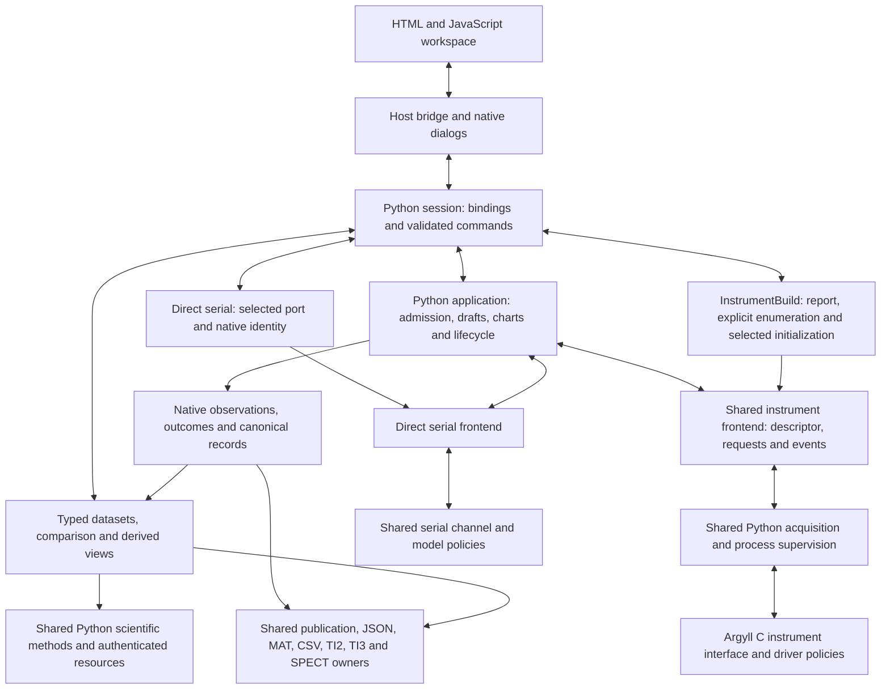

# Application architecture and implemented scope

The application combines Python state, acquisition and scientific owners with
an HTML/JavaScript workspace and Argyll C instrument workers. Its portable desktop
host uses Qt WebEngine without an HTTP server. MATLAB is a separate product and
is not a runtime dependency.

Separately maintained driver source owns the production worker's portable C
repairs and CR/PR protocol source; its history is not part of this release. This
application imports exact reviewed source with recorded hashes, then adds its
worker serialization, passive discovery, cancellation, deadlines, retained-result
policies and stricter CCSS
wavelength admission. Authenticated frozen predecessor text supplies the failing
side of regression proofs; the passing side reads current prepared production
source. Historical repair transforms and narrow build recipes have been removed.
One shared Argyll frontend serves the
supported models. Direct serial instruments use their existing shared byte
channel and the same application, persistence and analysis owners.

## Owners

The host and session translate explicit user actions into validated commands.
The application owns batch admission, drafts, chart state, retained outcomes and
recovery. The instrument frontend owns the common acquisition contract. Native
observations, derived quantities and display projections remain separate.

## Connected workflows

| Workflow | Reference and source boundary |
| --- | --- |
| Explicit instrument setup, binding and settings | [Equipment setup](desktop-equipment.md), [session](desktop-session.md), [generic frontend](generic-frontend.md) |
| Calibration, positioning, cancellation and typed outcomes | [Frontend operations](frontend.md), [instrument API](instrument.md), [application](application.md) |
| Guided chart, imported targets and saved continuation | [Chart state](chart-state.md), [chart context](chart-context.md), [chart sources](chart-sources.md) |
| Live and saved records, comparison and derived views | [Analysis workspace](analysis-workspace.md), [standalone records](standalone-records.md) |
| Color, illumination and relighting | [Scientific methods](science.md), [illumination](illumination.md), [chart science](chart-science.md) |
| Canonical JSON, MAT, CSV, TI2/TI3 and SPECT | [Data formats and eligibility](data-format.md) |
| Packaged workspace and native host | [Desktop application](desktop.md) |

Source descriptors govern admitted modes and controls. Refresh Hz, stored rates,
controlled timing and photometric observations remain different result types.
Missing XYZ or spectra remain unavailable; the application does not invent them.
Explicit Demo results remain simulated. Saved-source authentication and retained
publication payloads support retry without silently reacquiring a measurement.

## Delivery and validation limits

One Qt host serves macOS, Windows and Linux. A native worker build alone does
not establish desktop-package qualification on any of them. Software checks use simulation,
scripted transport and substituted instrument interfaces. Physical instrument
operation, optics, calibration accuracy and power-loss behavior remain unqualified.
Live-strip GUI acquisition is deferred; retained strip records use the existing
inspection and export paths. Device linking or advertised capability alone is
not proof of a physically working model/mode combination.

The [testing guide](testing.md) defines component checks and the full-form gate.
Connected checks trace workspace action, host/session dispatch, shared frontend,
typed retained result and save/review/recovery. Native reports authenticate
selected worker bytes and source inputs. Keep each claim bound to its actual
source, target and test substitutions; a green software gate does not establish
physical measurement validation.
