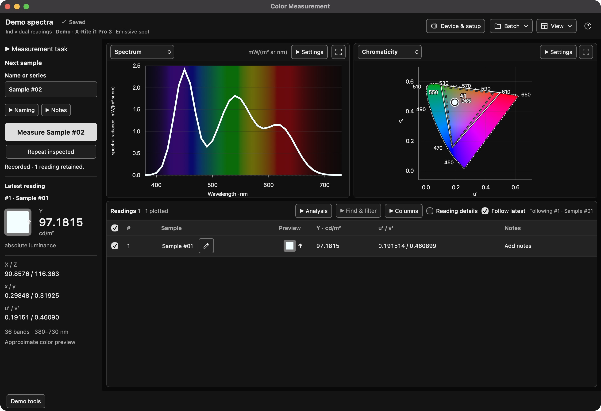

# User guide

Color Measurement is beta software for collecting readings, comparing samples
and reviewing saved results. Feedback on installation, clear instructions and
ordinary use is welcome. You do not need an instrument to try Demo.

For installation and platform requirements, start with
[getting started](getting-started.md). The desktop workspace currently runs on
macOS; Windows and Linux use the command line and Python interfaces.

## Take your first Demo reading

1. Open the app and choose **Try Demo**. Opening the app does not connect to equipment.
2. Keep the suggested Demo instrument and **Emissive spot** mode for this first try.
3. Name the batch, then choose **Create batch** and a new save folder.
4. Choose **Measure**. Confirm the prompts labelled as simulated calibration or positioning.
5. Inspect the reading in the table and plots. Try another reading with a different sample name.
6. Wait for **Saved**, then choose **Batch > Finish batch**.
7. Choose **Batch > Open saved batch…** and select that folder to review it.

Demo generates simulated readings. It does not connect to or calibrate a physical
instrument, and its values do not establish measurement accuracy.

*A simulated reading in the workspace. Displayed preview colors are illustrative.*

## Find your way around

- **Next sample** holds the name and notes for the next reading. The Measure button names its target.
- **Latest reading** summarizes the last result. Select a row or plot point to inspect another reading.
- **Spectra and chromaticity** show checked readings. Table checkboxes change what is plotted, not what is saved.
- **Find & filter** helps locate readings. **Columns** chooses the quantities shown in the table.
- **Follow latest** follows new readings as they arrive. Turn it off to inspect an earlier sample.
- **Device & setup** shows the current measurement settings. **Batch** contains saved-data and export actions.
- **Workspace help**, the question-mark button, explains the controls inside the app.

Unavailable values stay unavailable. For example, an XYZ-only reading has no
spectrum to plot. Units matter: luminance, illuminance, reflectance, frequency
and timing results are different quantities.

## Collect and repeat samples

Use a descriptive sample name and add any useful notes before measuring.
Readings save automatically in the batch folder. The header shows saving
progress and any error; wait for **Saved** before treating the files as current.

To repeat a reading, inspect it and use the Repeat control. The app keeps the
earlier result and the repeat, while retaining the prepared next sample.
Editing a saved sample's name or notes does not replace its acquired values.

For real equipment, read [testing with an instrument](testing-with-an-instrument.md)
before connecting. That guide covers initialization effects, calibration,
placement, cancellation and settings that may persist after use. Confirm a
physical preparation step only after performing it. Demo practice does not
qualify a physical instrument or mode.

## Compare readings

Open **Analysis > Compare** to select a reference reading and reference white.
The app keeps those choices explicit. Lab and color differences need suitable
reference conditions; a missing value is not a zero difference.

Use the plot controls to inspect spectra or differences, and the table to inspect
numerical values. **Analysis > Color** offers additional color views and scientific
calculations. Those calculations return derived results separately from the
original measurements. Preview swatches are illustrations, not proof that the
display reproduces a measured color.

The [scientific methods](science.md) and [illumination guide](illumination.md)
explain the assumptions behind the calculations.

## Work through a chart

Create an empty spot-reading batch, then choose **Batch > Guided chart setup…**.
Choose a Classic, Digital SG or custom grid, or import a supported TI2 target.
Review the chart's orientation and sample mapping before acquiring readings.

Each attempt belongs to its intended patch. Repeats and failed attempts remain
in the history; choose the result to use for each cell. Check coverage and missing
patches rather than assuming every displayed cell has a measurement.

A saved chart can be continued in a linked new batch when the instrument and
measurement conditions are suitable. Keep its source folder available. A chart
preview or placement advisory does not verify the physical target or its position.

## Reopen and export results

Choose **Batch > Open saved batch…** to open a batch folder or whole-batch MAT
archive. Saved data opens read-only. **Return to live** returns to the current
batch without changing the saved source.

**Batch > Export data…** exports the displayed dataset or checked readings as
analysis JSON, CSV or MAT. **Save whole batch MAT** keeps the batch files together
in one archive. Available formats depend on the quantities and installed support.

Keep the original batch folder. A CSV table, TI3 file or other supporting export
does not replace all of its original records and metadata. You can use exported
results in your own Python or MATLAB analysis; see the [data-format reference](data-format.md).

## If something goes wrong

- **Saving failed:** keep the app open. Use **Retry save** or **Another folder** to save the retained readings; measuring again is not a save-recovery step.
- **A value or format is unavailable:** read its explanation. A colorimeter may have no spectrum, or an analysis may need a reference white or compatible conditions.
- **A saved source changed:** reopen the original unchanged folder. Do not edit batch files by hand to force them to load.
- **An operation is still running:** use the app's cancellation control and wait for the final outcome. Do not start another application against the same device.
- **The app cannot load its bundled instrument software:** report the error. Use a complete matching app build rather than bypassing its checks.

Finish the batch and wait for saving to settle before closing. If closing reports
unsaved work or an uncertain operation state, read the choices and retain the
data before discarding anything.

## Send beta feedback

We need reports about Demo, confusing controls, installation, saved-data review
and instrument use. A short unsuccessful attempt can be as useful as a success.
You do not need to run a compiler or the software test suite to report an app bug.

Once repository hosting is available, choose **Software bug** for an application
problem, **Instrument session result** for an authorized equipment test, or
**Platform software report** if you built and checked another platform.

Include:

- The app version or source commit and your operating system.
- What you tried, what you expected and what happened.
- Whether you used Demo, saved data or a physical instrument.
- The exact error and, if useful, a small screenshot.

**Check screenshots and files before sharing.** Folder paths can reveal your
account name; readings can contain operator names, serial numbers, sample labels,
notes and confidential measurements. Share a minimal redacted copy and keep the
original locally. Do not attach a full batch or report folder without checking it.
Vulnerabilities use the [security reporting instructions](../SECURITY.md).

For builds without equipment, use [platform reports](platforms.md).
For real-device preparation and reporting, use the
[instrument guide](testing-with-an-instrument.md).
